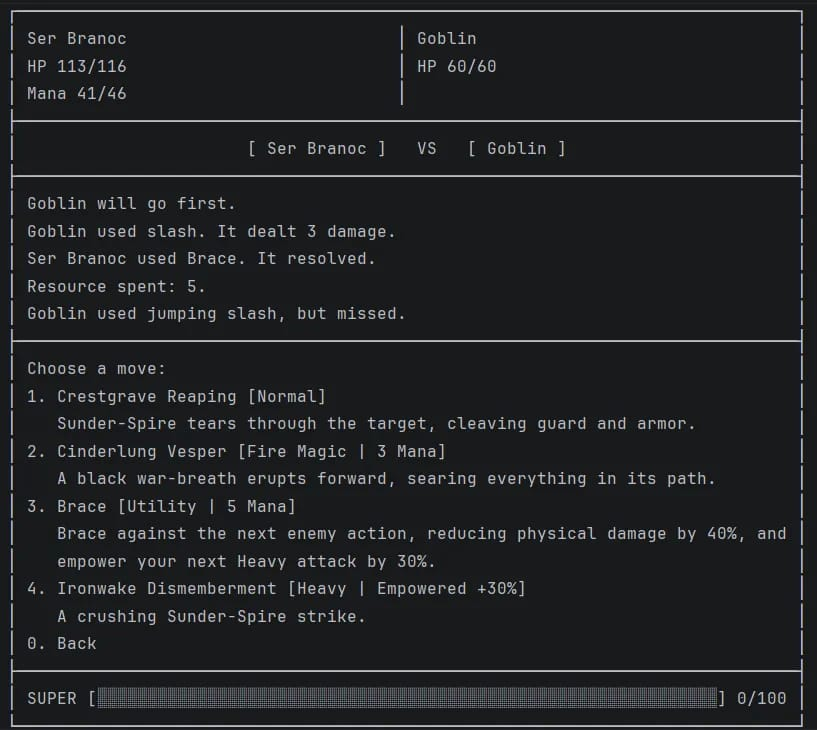
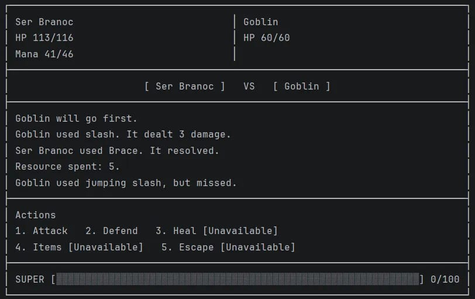
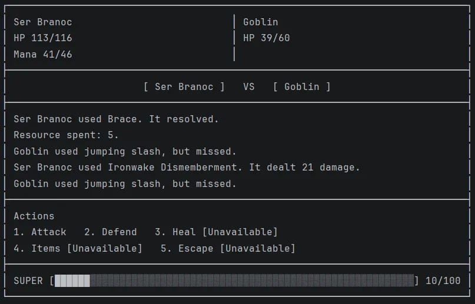

---
Dungeon Drifters is a character-driven fantasy RPG set in Ketlyv.

**Current version: v0.9**

Choose one of four distinct Drifters, master their unique combat style, grow
stronger through battle, evolve their signature weapon, and push deeper into
a dangerous world shaped by each character's identity and abilities.

The v0.9 game is a single-player RPG with a complete campaign through the
Floor V reunion boss, persistent progression, Hub services, expeditions, and
optional character stories. The same Python-authoritative gameplay rules power
the browser and terminal clients.

## The Drifters

#  Ser Branoc, the Unbroken Crest

A relentless close-range fighter built around endurance, retaliation, and
overwhelming physical force.

Branoc plants himself in the fight, survives what should break him, and answers
with brutal counterpressure. His signature weapon, Sunder-Spire, and techniques
such as Brace and Ironwake Dismemberment reinforce his identity:

**plant → endure → answer**

#  Azhvielle, the Unconfessed

A dangerous Black Mage whose combat style revolves around powerful magic,
Frost, Gravemantle, and calculated resource use.

Azhvielle can shape the pace of a fight through elemental pressure and
high-impact spell routes rather than meeting enemies head-on.

#  Zhaivra Kelyth, the Uncontrolled Reagent

A Rogue Archer built around preparation, precision, and alchemical aggression.

Zhaivra can prepare specialized payloads, including Fire and Poison Infused
Barbs, turning inventory preparation and status pressure into part of her
combat identity.

#  Joruun Veyr, the Bloody Storm Monk

A fast, aggressive Monk whose techniques draw on Water, Air, and Lightning.

Joruun chains martial pressure with elemental techniques, Stun, and rapid
combat flow to overwhelm enemies before they can settle into the fight.

## Current Playable Game

The campaign is playable in the browser and terminal, from the opening surface
route through the Floor V boss:

- Begin with the surface route, recruit companions, and grow a permanent
  four-Drifter roster. Choose a legal active pair for ordinary dungeon runs.
- Clear Floors I-III. Floor II lets the player choose D3 or D4 as a temporary
  third boss combatant; after its clear, both can be recruited independently
  at the Hub. Floor III's reunion boss requires all four permanent Drifters.
- Explore the Drowned Reliquary (Floor IV) with a pair, including its Rest
  checkpoints, discoveries, equipment and recovery rewards, and Tidebound
  Curator boss.
- Enter the Ashen Vault (Floor V) for a paired approach. Revealing its arena
  opens a separate Hub-launched battle against the Ashen Regent using all four
  permanent Drifters. On victory, Region 2 is permanently unlocked.
- Return to Region 1, replay completed floors, and continue the two-plus-two
  loop: the active pair explores while the other two Drifters can undertake a
  passive expedition. Reports are frozen at launch and claimed once; assignment
  categories appear only when their authored reward sources are eligible.
- Manage general goods, weapons and armor, enchanting, and consumable Alchemy
  through the Merchant, Blacksmith, Enchanter, and Alchemist. Vendor stock is
  finite; equipment inspection and equipping remain available independently.
- Advance each Drifter, spend Growth Points, respec, improve signature weapons,
  upgrade armor, equip fixed Rings and Pendants, and learn compatible armor
  affixes. Shared Momentum adds symmetric critical, damage, and mitigation
  advantages as either faction gains control in battle.
- Discover permanent world sources, complete optional pair stories and
  character memories, and use the Hub Region Portal to select available
  destinations.
- Save locally, reload, and continue persistent progression in either client.
  Cloud synchronization is not enabled in v0.9 builds.

**Campaign boundary:** M8 completes the finite Region 1 campaign through the
Ashen Regent and unlocks Region 2. Region 2 currently has no playable route, and
no Floor VI is included in v0.9. The static region and enemy illustrations are
presentation assets; the game does not include animated or graphical combat.

## Play Instructions

From the `root/` project directory, run:

```powershell
..\.venv\Scripts\python.exe src\run_game.py
```

You can also run `root/src/run_game.py` directly from PyCharm.

## Screenshots

The current terminal presentation is shown below:



*Structured move menu showing authored roles, resource costs, Brace rules, and the dynamic Ironwake payoff label.*



*Battle HUD showing the five ordinary actions, unavailable-state labels, bounded battle log, and persistent Super meter.*



*Battle log after Brace and an empowered Ironwake Dismemberment action.*


## Architecture

Dungeon Drifters is built around a modular, testable architecture that separates
game state, combat rules, authored content, presentation, and persistence.

Key foundations include:

- Structured `GameState` and player/world state ownership.
- A deterministic content-authoring system for Drifters, enemies, weapons,
  encounters, and routes.
- Resolver-driven turn-based combat with structured moves and results.
- Separate domain, presentation, and terminal UI layers.
- Versioned persistent game state with save/load support.
- Development tooling for content scaffolding, validation, and balance testing.

### Save and Cloud Data

The versioned `GameState` payload stores gameplay progression, including the
permanent roster and active pair, character advancement, shared inventory and
carried supplies, signature weapons, equipment, route state, and pending outing
rewards. Supported legacy disk saves are validated and migrated before use; the
original saved envelope is not mutated. A separate local profile envelope
stores the stable profile ID, optional DD account association, local sequence,
accepted remote revision, sync state, and payload digest. The local profile
store is authoritative for immediate play: saves are committed locally first,
and a player can continue playing, saving, quitting, and loading without an
account or network connection. **Cloud synchronization is not enabled in v0.9
builds.** The repository contains profile-sync interfaces and a DD-owned
HTTPS/JSON API backed by PostgreSQL as integration foundations for future host
support; they do not provide account linking or cloud sync in the v0.9 game.

The synchronization foundation keeps remote revisions immutable and idempotent.
A stale revision preserves the local branch and remote head as separate conflict
evidence; resolving it is explicit, with recovery data retained before the
active profile changes. Sync ordering does not depend on timestamps or silently
merge progression. These are architectural contracts, not features enabled in
the distributed v0.9 builds.

Accounts, linked platform identities, sessions, and entitlements remain service
data outside progression. Entitlements are account-scoped and service-owned;
source, expiry, and revocation can be represented without granting authority to
the client save. Ordinary earned gold remains gameplay data in `GameState`,
with dungeon-hub funds represented in the party state. Any future
platform-restricted currency must use separate account/service data rather than
game-state fields. Firebase has not been selected; provider integrations must
sit behind the DD contracts and be qualified independently on each platform.

See the project documentation and change log for detailed implementation history
and architecture.

## Testing

From the `root/` project directory:

```powershell
..\.venv\Scripts\python.exe -m pip install -r requirements-dev.txt
..\.venv\Scripts\python.exe -m pytest
..\.venv\Scripts\python.exe -m compileall src tests tools
```

## Project Structure

```text
Dungeon-Drifters/
├── docs/           # Project documentation
├── root/
│   ├── src/        # Game source
│   ├── tests/      # Test suite
│   └── tools/      # Development and validation tools
│   └── res/        # Game resources and screenshots
└── .github/        # CI workflows
```

The runnable Python project lives under `root/`; documentation, resources, and
repository-level configuration remain at the repository root.

## Change Log

The complete version history is maintained in the [change log](CHANGE_LOG.md).

## Contact

For questions or support, please get in touch with the maintainer:

- Email: [support@404builds.com](support@404builds.com)
- GitHub: [MrCodeGameAndAnime](https://github.com/MrCodeGameAndAnime)

## Development

- Use the [content authoring guide](CONTENT_AUTHORING.md)
  to add Drifters, enemies, weapons, encounters, or routes through the supported
  scaffolding and validation workflow.
- `root/tools/balance_probe.py` provides deterministic combat simulations and
  reproducible balance artifacts.
