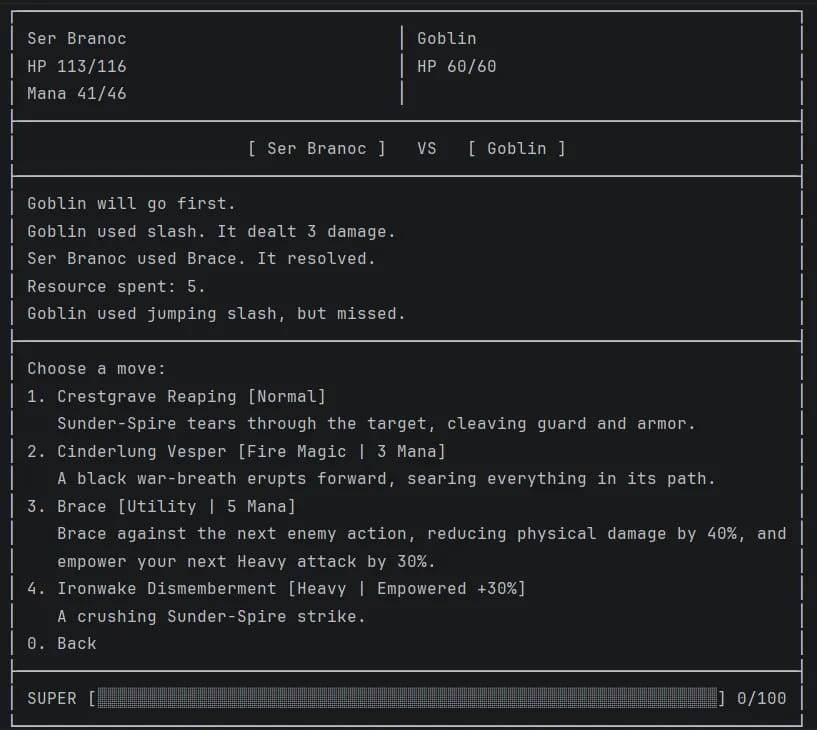
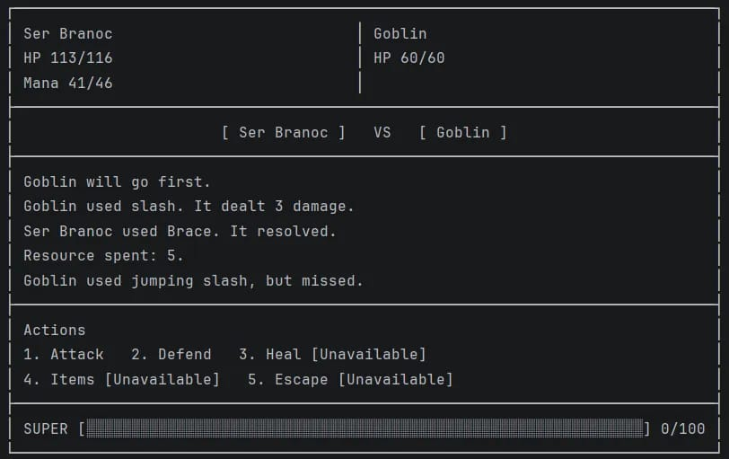
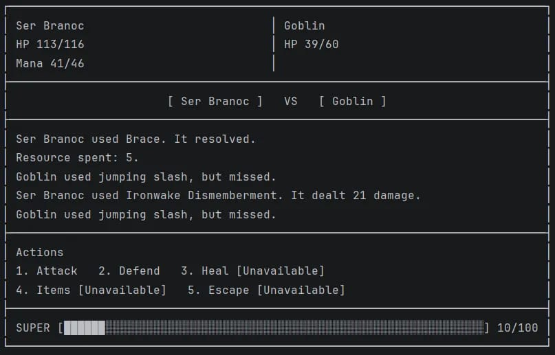

---
Dungeon Drifters is a character-driven fantasy RPG set in Ketlyv.

**Current version: v0.6**

Choose one of four distinct Drifters, master their unique combat style, grow
stronger through battle, evolve their signature weapon, and push deeper into
a dangerous world shaped by each character's identity and abilities.

The game is in active development. The current build includes the surface
route, the Hub, and the first dungeon floor. The same Python gameplay runtime
is playable in the browser and through the terminal.

## The Drifters

#  Ser Branoc, the Unbroken Crest

A relentless close-range fighter built around endurance, retaliation, and
overwhelming physical force.

Branoc plants himself in the fight, survives what should break him, and answers
with brutal counterpressure. His signature weapon, Sunder-Spire, and techniques
such as Brace and Ironwake Dismemberment reinforce his identity:

**plant → endure → answer**

#  Azhvielle, the Unconfessed

A dangerous Black Mage whose combat style revolves around powerful magic,
Frost, Gravemantle, and calculated resource use.

Azhvielle can shape the pace of a fight through elemental pressure and
high-impact spell routes rather than meeting enemies head-on.

#  Zhaivra Kelyth, the Uncontrolled Reagent

A Rogue Archer built around preparation, precision, and alchemical aggression.

Zhaivra can prepare specialized payloads, including Fire and Poison Infused
Barbs, turning inventory preparation and status pressure into part of her
combat identity.

#  Joruun Veyr, the Bloody Storm Monk

A fast, aggressive Monk whose techniques draw on Water, Air, and Lightning.

Joruun chains martial pressure with elemental techniques, Stun, and rapid
combat flow to overwhelm enemies before they can settle into the fight.

## Current Playable Build

The current build contains the opening sequence for all four Drifters:

- Play eight authored surface encounters that escalate from lone Goblins to the Goblin Lord.
- Recruit a companion in the Hub and fight as a two-Drifter party.
- Enter Floor I's ten battles and two Rest points, ending with the Goblin Lord.
- Extract to the Hub to secure rewards, inspect the party, and prepare another run.
- Use the Hub merchant to craft and install signature-weapon components and improve weapon slots.
- Inspect character progression, skills, inventory, map, and signature weapons.
- Save, quit, load, and continue with persistent progression; cloud synchronization is optional.

Floor I and return to the Hub are the current dungeon endpoint. Later floors and
the M1-M9 systems remain in development.

## Play Instructions

From the `root/` project directory, run:

```powershell
..\.venv\Scripts\python.exe src\run_game.py
```

You can also run `root/src/run_game.py` directly from PyCharm.

## Screenshots

The current terminal presentation is shown below:



*Structured move menu showing authored roles, resource costs, Brace rules, and the dynamic Ironwake payoff label.*



*Battle HUD showing the five ordinary actions, unavailable-state labels, bounded battle log, and persistent Super meter.*



*Battle log after Brace and an empowered Ironwake Dismemberment action.*


## Architecture

Dungeon Drifters is built around a modular, testable architecture that separates
game state, combat rules, authored content, presentation, and persistence.

Key foundations include:

- Structured `GameState` and player/world state ownership.
- A deterministic content-authoring system for Drifters, enemies, weapons,
  encounters, and routes.
- Resolver-driven turn-based combat with structured moves and results.
- Separate domain, presentation, and terminal UI layers.
- Versioned persistent game state with save/load support.
- Development tooling for content scaffolding, validation, and balance testing.

### Save and Cloud Data

The schema-11 `GameState` payload contains progression only, including the
recruited party, shared hub inventory, and pending outing rewards. Existing
schema-8 through schema-11 disk payloads remain readable and are migrated only
after their original envelope digest is verified; new disk saves use schema 12.
A separate version-1 local profile envelope stores the stable profile ID,
optional DD account association, local sequence, accepted remote revision, sync
state, and payload digest. The local profile store is authoritative for
immediate play: saves are committed locally first, and a player can continue
playing, saving, quitting, and loading without an account or network connection.

Optional cloud sync uses the DD-owned HTTPS/JSON profile API backed by
PostgreSQL. The game depends on profile and transport interfaces, not on
FastAPI, a vendor SDK, or a particular HTTP library. Host adapters supply
transport and credential storage; credentials never enter a game-state payload
or profile envelope. Cloud revisions are immutable and idempotent. A stale
revision preserves the local branch and remote head as separate conflict
evidence; resolving it is explicit, with recovery data retained before the
active profile changes. Sync ordering never depends on timestamps or silently
merges progression.

Accounts, linked platform identities, sessions, and entitlements remain service
data outside progression. Entitlements are account-scoped and service-owned;
source, expiry, and revocation can be represented without granting authority to
the client save. Ordinary earned gold remains gameplay data in `GameState`,
with dungeon-hub funds represented in the party state. Any future
platform-restricted currency must use separate account/service data rather than
game-state fields. Firebase has not been selected; provider integrations must
sit behind the DD contracts and be qualified independently on each platform.

See the project documentation and change log for detailed implementation history
and architecture.

## Testing

From the `root/` project directory:

```powershell
..\.venv\Scripts\python.exe -m pip install -r requirements-dev.txt
..\.venv\Scripts\python.exe -m pytest
..\.venv\Scripts\python.exe -m compileall src tests tools
```

## Project Structure

```text
Dungeon-Drifters/
├── root/
│   ├── src/        # Game source
│   ├── tests/      # Test suite
│   └── tools/      # Development and validation tools
├── docs/           # Project documentation
├── res/            # Screenshots and other resources
└── .github/        # CI workflows
```

The runnable Python project lives under `root/`; documentation, resources, and
repository-level configuration remain at the repository root.

## Change Log

The complete version history is maintained in the [change log](CHANGE_LOG.md).

## Contact

For questions or support, please get in touch with the maintainer:

- Email: [support@404builds.com](support@404builds.com)
- GitHub: [MrCodeGameAndAnime](https://github.com/MrCodeGameAndAnime)

## Development

- Use the [content authoring guide](CONTENT_AUTHORING.md)
  to add Drifters, enemies, weapons, encounters, or routes through the supported
  scaffolding and validation workflow.
- `tools/balance_probe.py` provides deterministic combat simulations and
  reproducible balance artifacts.
