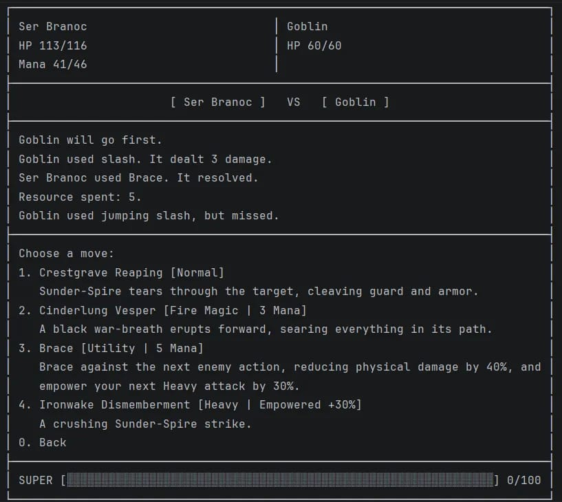
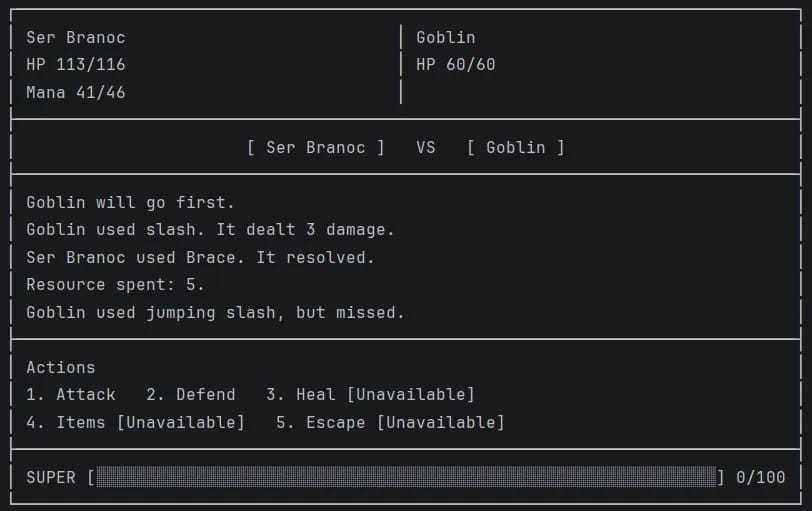
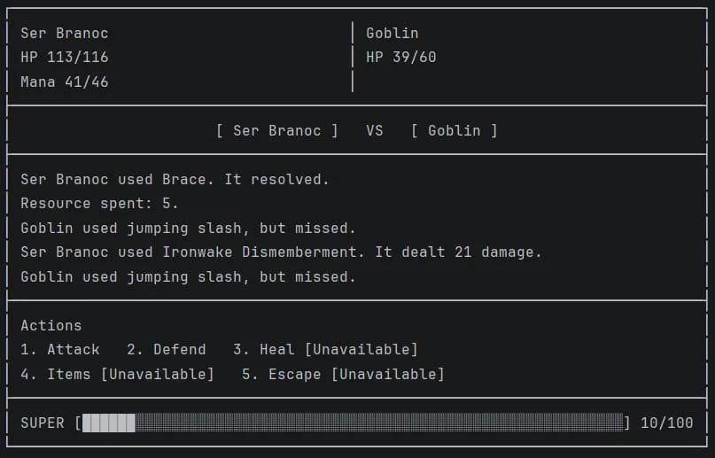

---
Dungeon Drifters is a character-driven fantasy RPG set in Ketlyv.

**Latest release: v0.6**

Choose one of four distinct Drifters, master their unique combat style, grow
stronger through battle, evolve their signature weapon, and push deeper into
a dangerous world shaped by each character's identity and abilities.

The game is in active development. The current development build includes the
surface route, the Hub, and the first three dungeon floors. The same Python
gameplay runtime is playable in the browser and through the terminal. The v0.6
release endpoint remains Floor I; Floors II and III are unreleased development
content.

## The Drifters

#  Ser Branoc, the Unbroken Crest

A relentless close-range fighter built around endurance, retaliation, and
overwhelming physical force.

Branoc plants himself in the fight, survives what should break him, and answers
with brutal counterpressure. His signature weapon, Sunder-Spire, and techniques
such as Brace and Ironwake Dismemberment reinforce his identity:

**plant → endure → answer**

#  Azhvielle, the Unconfessed

A dangerous Black Mage whose combat style revolves around powerful magic,
Frost, Gravemantle, and calculated resource use.

Azhvielle can shape the pace of a fight through elemental pressure and
high-impact spell routes rather than meeting enemies head-on.

#  Zhaivra Kelyth, the Uncontrolled Reagent

A Rogue Archer built around preparation, precision, and alchemical aggression.

Zhaivra can prepare specialized payloads, including Fire and Poison Infused
Barbs, turning inventory preparation and status pressure into part of her
combat identity.

#  Joruun Veyr, the Bloody Storm Monk

A fast, aggressive Monk whose techniques draw on Water, Air, and Lightning.

Joruun chains martial pressure with elemental techniques, Stun, and rapid
combat flow to overwhelm enemies before they can settle into the fight.

## Current Playable Build

The current development build is playable in the browser and terminal and
covers the route through the Floor III boss:

- Play the eight-encounter surface route through the Goblin Lord.
- Recruit and manage the permanent Drifter roster in the Hub, then choose an
  active pair for ordinary encounters.
- Complete Floor I's ten encounters, two Rest points, and Goblin Lord; extract
  to the Hub to secure rewards and prepare another run.
- Continue through Floor II's ten encounters and two Rest points. At the
  pre-boss Rest, choose D3 or D4 as a temporary third combatant for the boss.
  The helper does not join the permanent roster or receive boss XP.
- After clearing Floor II, recruit D3 and D4 independently in the Hub for 65
  shared gold each. Permanent recruits start at Level 1.
- Complete Floor III's ten encounters and two Rest points. Ordinary encounters
  use the active pair; the final boss requires all four permanent Drifters.
  Pre-boss rewards stay with their earning pair, while boss XP is split across
  the four participants before each one's Intuition bonus.
- Store supplies in the Hub, prepare a six-unit carried pack, use consumables
  and alchemy, and choose between Rest, extraction, and emergency exits.
- Spend Growth Points on character advancement, manage each Drifter's move
  loadout, and respec at the Hub.
- Craft and install signature-weapon components, improve weapon slots, manage
  armor and fixed Ring/Pendant equipment, and use the Alchemist's armor and
  modifier services. Ordinary Floor II armor-drop sources are not yet authored.
- Inspect the party, inventory, map, and equipment; save, quit, load, and
  continue with persistent progression. Cloud synchronization is optional.

Floor IV expeditions and the later M6-M9 systems remain future work.

## Play Instructions

From the `root/` project directory, run:

```powershell
..\.venv\Scripts\python.exe src\run_game.py
```

You can also run `root/src/run_game.py` directly from PyCharm.

## Screenshots

The current terminal presentation is shown below:



*Structured move menu showing authored roles, resource costs, Brace rules, and the dynamic Ironwake payoff label.*



*Battle HUD showing the five ordinary actions, unavailable-state labels, bounded battle log, and persistent Super meter.*



*Battle log after Brace and an empowered Ironwake Dismemberment action.*


## Architecture

Dungeon Drifters is built around a modular, testable architecture that separates
game state, combat rules, authored content, presentation, and persistence.

Key foundations include:

- Structured `GameState` and player/world state ownership.
- A deterministic content-authoring system for Drifters, enemies, weapons,
  encounters, and routes.
- Resolver-driven turn-based combat with structured moves and results.
- Separate domain, presentation, and terminal UI layers.
- Versioned persistent game state with save/load support.
- Development tooling for content scaffolding, validation, and balance testing.

### Save and Cloud Data

The versioned `GameState` payload stores gameplay progression, including the
permanent roster and active pair, character advancement, shared inventory and
carried supplies, signature weapons, equipment, route state, and pending outing
rewards. Supported legacy disk saves are validated and migrated before use; the
original saved envelope is not mutated. A separate local profile envelope
stores the stable profile ID, optional DD account association, local sequence,
accepted remote revision, sync state, and payload digest. The local profile
store is authoritative for immediate play: saves are committed locally first,
and a player can continue playing, saving, quitting, and loading without an
account or network connection.

Optional cloud sync uses the DD-owned HTTPS/JSON profile API backed by
PostgreSQL. The game depends on profile and transport interfaces, not on
FastAPI, a vendor SDK, or a particular HTTP library. Host adapters supply
transport and credential storage; credentials never enter a game-state payload
or profile envelope. Cloud revisions are immutable and idempotent. A stale
revision preserves the local branch and remote head as separate conflict
evidence; resolving it is explicit, with recovery data retained before the
active profile changes. Sync ordering never depends on timestamps or silently
merges progression.

Accounts, linked platform identities, sessions, and entitlements remain service
data outside progression. Entitlements are account-scoped and service-owned;
source, expiry, and revocation can be represented without granting authority to
the client save. Ordinary earned gold remains gameplay data in `GameState`,
with dungeon-hub funds represented in the party state. Any future
platform-restricted currency must use separate account/service data rather than
game-state fields. Firebase has not been selected; provider integrations must
sit behind the DD contracts and be qualified independently on each platform.

See the project documentation and change log for detailed implementation history
and architecture.

## Testing

From the `root/` project directory:

```powershell
..\.venv\Scripts\python.exe -m pip install -r requirements-dev.txt
..\.venv\Scripts\python.exe -m pytest
..\.venv\Scripts\python.exe -m compileall src tests tools
```

## Project Structure

```text
Dungeon-Drifters/
├── docs/           # Project documentation
├── root/
│   ├── src/        # Game source
│   ├── tests/      # Test suite
│   └── tools/      # Development and validation tools
│   └── res/        # Game resources and screenshots
└── .github/        # CI workflows
```

The runnable Python project lives under `root/`; documentation, resources, and
repository-level configuration remain at the repository root.

## Change Log

The complete version history is maintained in the [change log](CHANGE_LOG.md).

## Contact

For questions or support, please get in touch with the maintainer:

- Email: [support@404builds.com](support@404builds.com)
- GitHub: [MrCodeGameAndAnime](https://github.com/MrCodeGameAndAnime)

## Development

- Use the [content authoring guide](CONTENT_AUTHORING.md)
  to add Drifters, enemies, weapons, encounters, or routes through the supported
  scaffolding and validation workflow.
- `root/tools/balance_probe.py` provides deterministic combat simulations and
  reproducible balance artifacts.
